<div align="center">

# Claudio

**A tiny, always-on-top 3D office for your Claude Code sessions.**

Your agents sit at their desks in the corner of your screen. Subagents walk in, work and leave.
Permission prompts and questions pop up as cards you answer with a click, and you can message
any agent without switching to the terminal. No API key needed.

[](https://github.com/SefaSelim/claudio/actions/workflows/ci.yml)
[](https://github.com/SefaSelim/claudio/releases)
[](https://sefaselim.github.io/claudio/)


### [▶ Try the live demo](https://sefaselim.github.io/claudio/) · [⬇ Download for Windows](https://github.com/SefaSelim/claudio/releases/latest) · [📖 User guide](docs/USAGE.md)

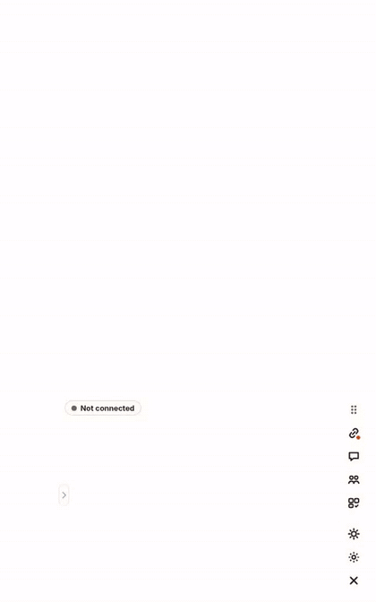

</div>

> **About the demo:** the web demo runs a pre-written session in your browser. It doesn't
> connect to any AI, call an API or send anything anywhere. The desktop app doesn't use an
> API key either: it attaches to the Claude Code sessions you already run on your own machine.

---

## Contents

- [Why Claudio](#why-claudio)
- [Features](#features)
- [Install](#install)
- [Connect to Claude Code](#connect-to-claude-code)
- [How it works](#how-it-works)
- [Development](#development)
- [How it compares](#how-it-compares)
- [Contributing](#contributing)

## Why Claudio

Claude Code works best when you let it run, but then you're always checking the terminal:
*is it still working? Is it waiting for me? Did that subagent finish?* Claudio puts the answer
in a 480×750 widget that floats over everything else. You see what's happening at a glance,
and you answer only when something needs you.

- **Two-way, not just a dashboard.** You can send messages, files and images, answer
  permissions and questions, and hold meetings. All of it goes into the session you're
  already running.
- **Truthful.** Everything on screen comes from Claude Code itself: hooks, the session
  registry, transcripts and the task list. Nothing is invented.
- **Quiet by default.** Animations are short, and sounds and notifications are opt-in. Clicks
  outside the room go through to the windows behind it.

## Features

### The office

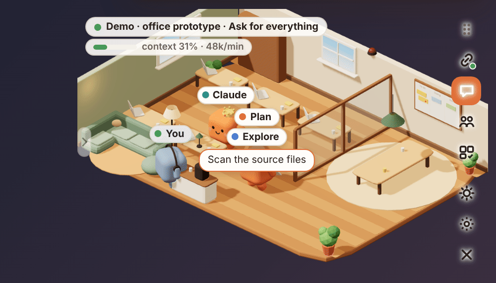

- The **main agent** sits at its own desk. **Subagents** come in through the door, pick a free
  desk and leave when they're done.
- **Tool calls become animations** and speech bubbles: typing, reading, running commands.
  Claude dozes off when idle, raises a hand when it needs you and tidies its desk while it
  compacts the context.
- **"You"** is a blue felt character. It carries every message you send to the right desk.
- **Day and evening lighting** follows the clock, or you can set it yourself.
- **Fold it away:** an arrow on the left folds the office into the dock. The scene stops
  rendering while it's folded.

<br clear="right">

### Answer from the office

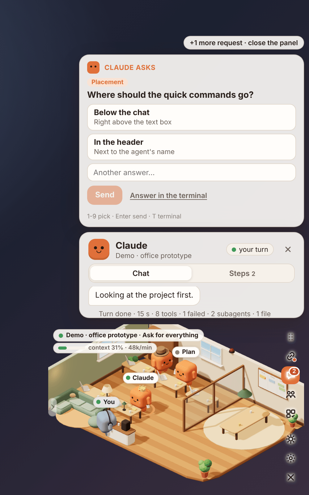

- `PermissionRequest` and `AskUserQuestion` are **held until you answer in the office**. You
  can allow, deny, *always allow in this session*, *allow and auto-accept edits*, or leave it
  to the terminal.
- **Keyboard:** <kbd>Enter</kbd> allows, <kbd>N</kbd> denies, <kbd>T</kbd> leaves it to the
  terminal, <kbd>1</kbd>–<kbd>9</kbd> picks an answer.
- **Other sessions:** if a session the office isn't attached to starts waiting for you, the
  session button blinks and you get a Windows notification.

<br clear="right">

### Talk to any agent

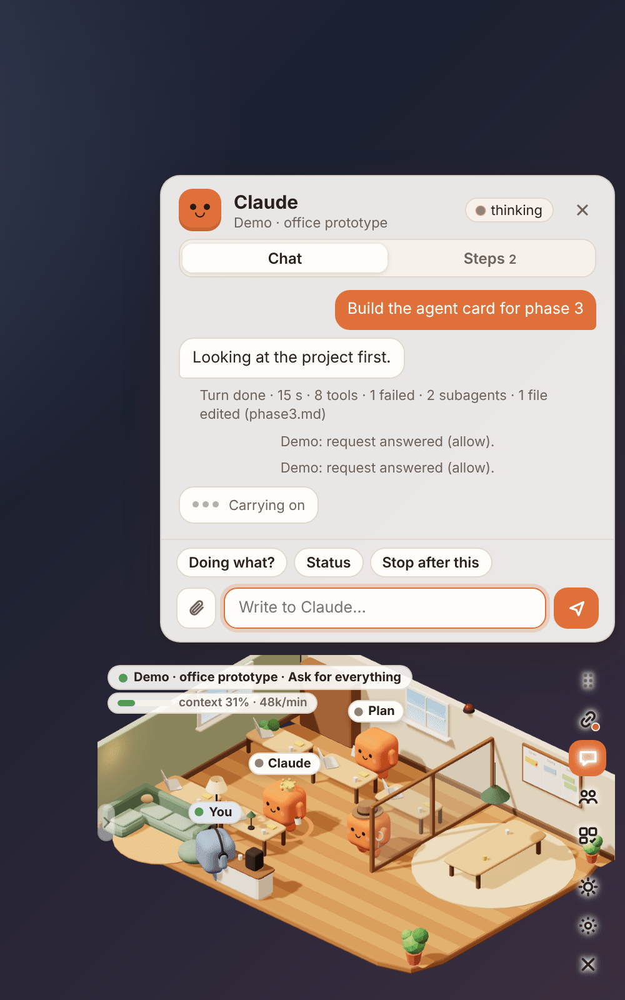

- Click a character to open its card, with a **Chat** tab and a **Steps** tab.
- Write to the **main agent or one specific subagent**. You can attach files and images with
  <kbd>Ctrl</kbd>+<kbd>V</kbd> or drag and drop.
- Messages are delivered at the next tool call, at the end of the turn, or by **waking an idle
  session**. Each message shows how it was delivered.
- **Turn recap:** when a turn ends, one line shows how long it took, how many tools ran, the
  failures, the subagents and the files that were edited.
- **Office commands:** `/status`, `/agents`, `/tasks`, `/meeting`, `/alarm`, `/all-clear`,
  `/clear` and `/help`.

<br clear="right">

### Steps, signals and alarm

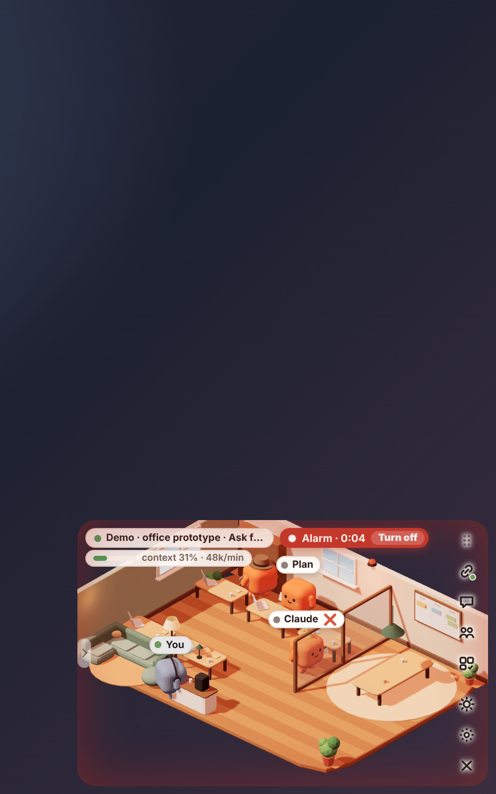

- The **Steps** tab lists every tool call. Failed calls are red, and it also shows the run
  time and the subagent's model and tokens.
- **Signals:** deploy, build, test and push commands get an icon over the agent, then ✅ or ❌.
- **Alarm:** a failed deploy, or three failures in five minutes, turns the room red. It clears
  after a green run or ten quiet minutes.
- **Meter:** a thin bar under the badge shows how full the context is and the tokens per minute.

<br clear="right">

### Office agents and meetings

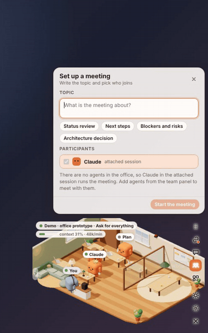

- Add up to **five agents from a library**: your project's `.claude/agents`, your own
  `~/.claude/agents`, enabled plugins, or any GitHub repository. For example,
  [Claude Code Game Studios](https://github.com/Donchitos/Claude-Code-Game-Studios) is one
  click away.
- Each office agent runs in **its own Claude Code session** (`claude -p --agent`) and keeps its
  context across tasks and restarts. Between tasks it rests on the L-shaped sofa.
- **Meetings:** agents take turns speaking and you can interrupt. Agents that were working
  take a break and pick their work back up after the summary.

<br clear="right">

### Sessions, team and settings

| Sessions | Team & tasks | Settings |
|:-:|:-:|:-:|
| 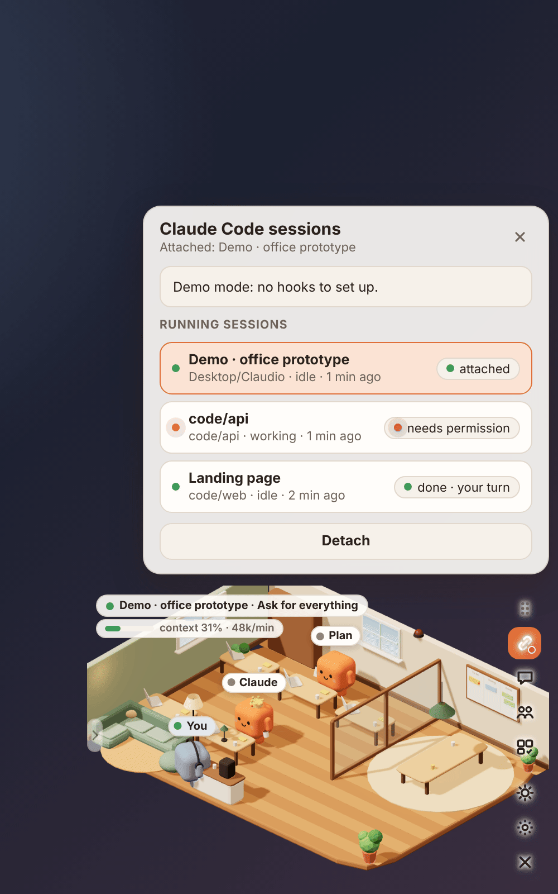 | 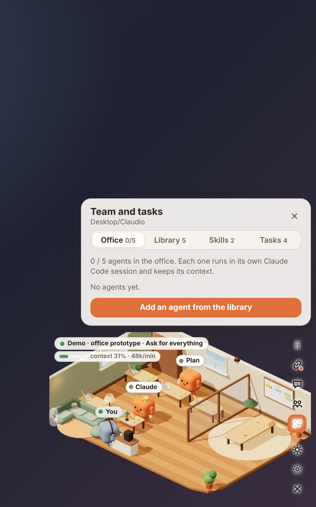 | 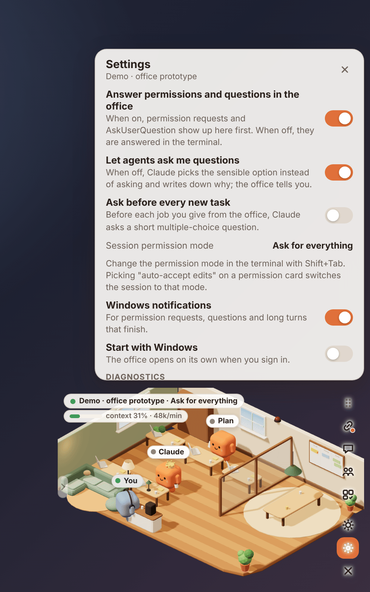 |
| Every running session. Sessions waiting for you, or finished and waiting for your turn ("done · your turn"), are marked. | Office agents, the agent library, skills, and the session's task list. The task list also appears as post-its on the whiteboard. | Answering in the office, question behaviour, Windows notifications, sound, start with Windows, and a **diagnostics** block that checks every step of the setup. |

<div align="center">
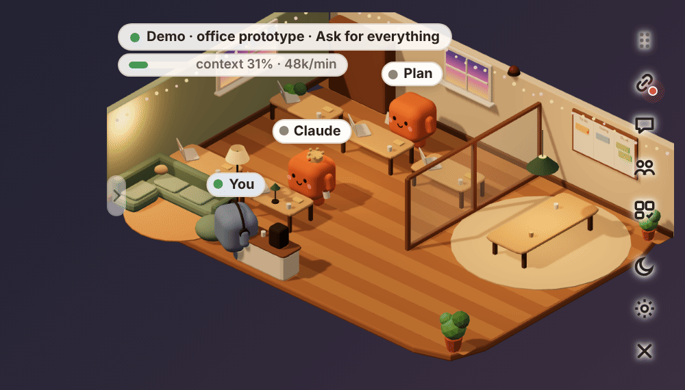
<br><sub>Evening mode.</sub>
</div>

## Install

### Windows installer

1. Install [Node.js 20+](https://nodejs.org). The bridge runs on Node.
2. Download `Claudio Office_<version>_x64-setup.exe` from
   [Releases](https://github.com/SefaSelim/claudio/releases) and run it. If SmartScreen says
   "unknown publisher", click **More info → Run anyway**.
3. The office opens in the bottom-right corner, always on top. It doesn't appear in the taskbar;
   use the tray icon to show or hide it.

### From source

Requirements: Node.js 20+, Rust (stable, `x86_64-pc-windows-msvc`), the MSVC C++ build tools
with the Windows SDK, and WebView2 (preinstalled on Windows 11).

```bash
npm install
```

```bash
npm run tauri dev
```

To build the installer, run `npm run tauri build`. Close the office with the × at the bottom of
the dock.

## Connect to Claude Code

1. Open the **session** panel (the chain icon) and press **Set up the connection**. Claudio backs up `~/.claude/settings.json` to `settings.json.claudio-backup`
   and adds **only its own hooks**. Running sessions pick them up without a restart.
2. Start `claude` in a terminal, or use one that's already running, then click it in the list.

While the office is closed, the hooks don't block anything. **Remove** deletes only
Claudio's hooks and leaves yours alone.

## How it works

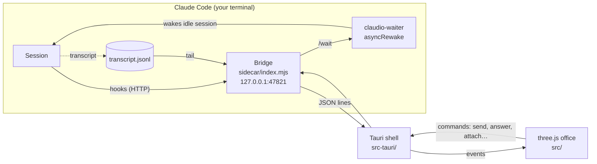

- **Watching:** the session list comes from `~/.claude/sessions`, chat comes from the
  transcript, and agent and tool states come from hooks.
- **Holding requests:** the bridge keeps the `PermissionRequest` / `PreToolUse` HTTP hook open
  until you answer in the office. If the terminal answers first, the card disappears.
- **Delivering messages:** Claude Code has no official way to inject a user message, so office
  messages go in as `additionalContext` after the next tool call (failed calls included), as a
  `Stop` hook *block* at the end of a turn, or through the `asyncRewake` waiter when the
  session is idle. Claude sees them as *"The user wrote from Claudio Office"*.
- **Office agents** are headless `claude -p` sessions created and resumed by the bridge with
  `--session-id` / `--resume`.

| Path | What it is |
|---|---|
| `src-tauri/` | Transparent window, click-through outside `data-hit` shapes, position memory, tray, autostart, the bridge process |
| `sidecar/index.mjs` | Hook receiver, session list, transcript tail, message queue, held requests |
| `sidecar/hooks-config.mjs` | Adds and removes Claudio's hooks in `settings.json` |
| `sidecar/workers.mjs`, `library.mjs` | Office agents, meetings, agent library and repository import |
| `sidecar/roster.mjs`, `signals.mjs` | Project agents, skills and task list; shell command classifier |
| `src/scene.js`, `office.js`, `characters.js` | The three.js office, felt characters and walking paths |
| `src/session.js`, `turns.js` | Office state from bridge events; turn recaps |
| `src/ui.js` | Dock, panels, cards, agent tags |
| `test/` | `node:test` suites, including end-to-end tests of the bridge |

## Development

```bash
npm test
```

```bash
npx vite build
```

- **Browser demo:** `npm run build:demo`, then `npx vite preview`. It's the same build that
  [GitHub Pages](https://sefaselim.github.io/claudio/) serves, deployed by
  `.github/workflows/pages.yml` on every push to `main`. A local build also plays the demo at
  `/?scene-demo`; add `&alarm` for the failing-tests run and `&hits` to see which areas catch
  clicks.
- **Fake bridge:** run `CLAUDIO_FAKE=1 npm run tauri dev` to try the full app without a real
  session.
- **README media:** `scripts/capture-media.cjs` regenerates every screenshot and GIF from the
  demo build with Playwright and ffmpeg.
- **UI checks:** `scripts/ui-audit.cjs` walks the demo through every panel, card and state at
  the app's 482×750 size, on a laptop screen and on a phone, and reports overlapping or cut-off
  text, anything off screen and clicks that cannot land; `scripts/ui-smoke.cjs` checks the
  keyboard shortcuts, office commands and settings. Both need Playwright with Chromium.
- **CI** runs the bridge tests, the frontend build and the Rust tests. A `vX.Y.Z` tag builds
  the Windows installers into a draft release.

Roadmap and design notes: [docs/plan-v1.md](docs/plan-v1.md). Release history:
[CHANGELOG.md](CHANGELOG.md).

## How it compares

There are plenty of good tools for running or watching Claude Code. Claudio is different in
three ways: it **stays on screen** as a widget rather than a browser tab, it's **two-way**
(messages, permissions, questions, meetings), and it **attaches** to sessions you already run
instead of launching its own. See
[docs/research-agent-managers.md](docs/research-agent-managers.md) for a comparison with Pixel
Agents, Claude Squad, Conductor, Vibe Kanban, claude-pulse, Claude Radar, ccmonitor and others,
and for which of their ideas Claudio has adopted.

## Contributing

Issues and pull requests are welcome.

- Commits follow [Conventional Commits](https://www.conventionalcommits.org/) with the scopes
  `bridge`, `hooks`, `ui`, `scene`, `window`, `session`, `deps` and `release`.
- User-facing changes add a line to `CHANGELOG.md` under `[Unreleased]`.
- Run `npm test` and `npx vite build` before opening a PR (and `cargo build` in `src-tauri/` if
  you touched Rust).
- Issues and PRs use the labels in [`.github/labels.yml`](.github/labels.yml).

The full working agreement is in [CLAUDE.md](CLAUDE.md).
